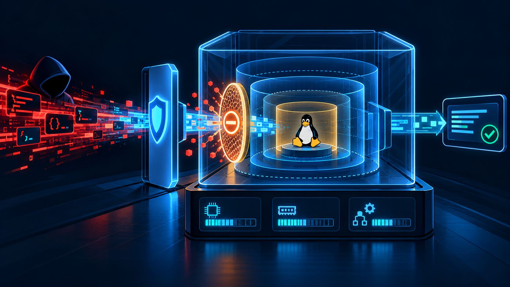
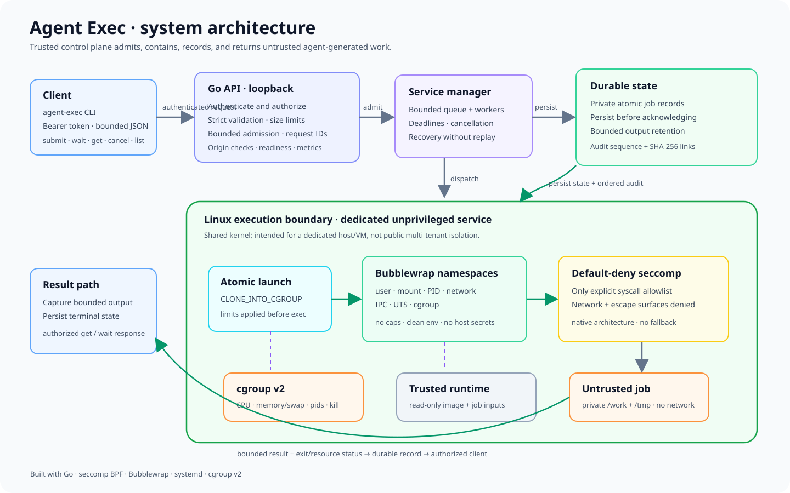
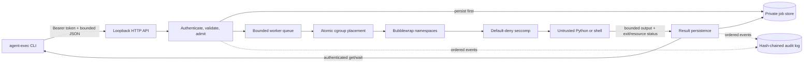
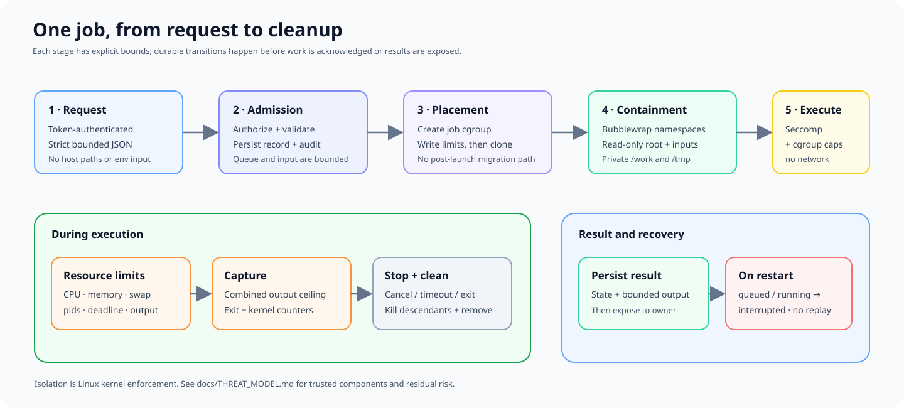

# Agent Exec



**A local execution service for agent-generated Python and shell workloads, built around Linux-enforced containment.** Agent Exec accepts jobs through an authenticated asynchronous API, admits only bounded requests, runs each job inside a constrained sandbox, and returns a recorded result.

[](https://github.com/Deep-Patel2002/agent-exec/actions/workflows/ci.yml)


> **Deployment scope:** one dedicated Linux host or VM with a loopback API. Jobs share the Linux kernel. This is not a microVM service or a public multi-tenant SaaS. The project has local verification evidence; no independent security audit or production operating history is claimed.

## System design



The system separates a trusted Go control plane from untrusted job code. The API authenticates the caller, validates and bounds the request, checks admission capacity, and persists the job before acknowledging it. A worker creates a resource-limited cgroup and launches Bubblewrap directly into it with `CLONE_INTO_CGROUP`; inside that boundary, namespaces, a read-only runtime image, private temporary filesystems, and a default-deny seccomp filter constrain execution. Results and audit events are persisted before they are exposed to the client.

### Request and execution path



### Isolation and trust boundaries



The job supplies argument strings and input file contents only. It cannot select host paths, environment variables, the runtime image, or the syscall policy. The runtime image and policy are operator-owned trusted artifacts. Network syscalls, nested namespace operations, ptrace, BPF, mounts, and other unlisted calls are denied by the initial seccomp policy. Cgroup limits and a combined output budget bound resource use; cancellation and completion kill leftover descendants.

The Linux kernel, hypervisor/VM boundary when present, systemd, Bubblewrap, the service, policy generator, and installed runtime image remain trusted. A kernel or trusted-component escape is outside this boundary. See the [threat model](docs/THREAT_MODEL.md) for abuse cases and residual risks.

## Capabilities

- **Constrained execution:** fixed read-only runtime image and inputs; private ephemeral `/work` and `/tmp`; fresh user, mount, PID, network, IPC, UTS, and cgroup namespaces.
- **Kernel resource controls:** atomic `CLONE_INTO_CGROUP` launch, memory and swap, CPU bandwidth, process limits, deadlines, and `cgroup.kill` descendant cleanup.
- **Narrow syscall surface:** native-architecture, default-deny seccomp BPF; no capabilities, inherited host environment, or network syscalls in the initial policy.
- **Authenticated async API:** hashed bearer credentials, per-principal job access, strict JSON, bounded queue and output, cancellation, readiness, and metrics.
- **Durable operations:** private atomic job records, synchronous hash-chained audit writes, restart recovery without replay, and hardened systemd deployment.
- **Portable development:** Go control plane and client run control-plane tests on Linux, macOS, and Windows; actual workload isolation requires Linux with cgroup v2.

## Job lifecycle


`queued → running → succeeded | failed | timed_out | cancelled | output_limit | resource_exhausted`

On restart, persisted queued and running jobs become `interrupted`; they are never automatically replayed. A failed audit or storage operation stops new admission. Output is returned only through the authenticated job API and is subject to count-based retention.

## Quick start

### Requirements

- Go **1.27.3** (module requires Go 1.25+)
- Linux runtime: unified cgroup v2, delegated systemd unit, dedicated unprivileged account, and non-setuid Bubblewrap 0.9+
- C compiler and libseccomp development files to build the native seccomp policy

Windows and macOS support client builds and control-plane tests; they do not run the Linux sandbox backend.

### Build and test

```sh
go test ./...
go vet ./...
make build seccomp
```

### Install on a dedicated Ubuntu VM

Review the [Ubuntu AppArmor namespace policy setup](docs/DEPLOYMENT.md#ubuntu-apparmor-namespace-policy) and deployment requirements first.

```sh
sudo apt-get update
sudo apt-get install -y bubblewrap libseccomp-dev gcc make python3
make build seccomp
sudo bash tools/install-local.sh
sudo systemctl start agent-exec.service
sudo systemctl status agent-exec.service
```

The installer creates a local credential without printing it. Submit and wait as the service account (or transfer the token through a private channel):

```sh
sudo -u agentexec /opt/agent-exec/bin/agent-exec \
  -token-file /var/lib/agent-exec/auth/client.token \
  submit examples/hello.json

sudo -u agentexec /opt/agent-exec/bin/agent-exec \
  -token-file /var/lib/agent-exec/auth/client.token \
  wait JOB_ID
```

The CLI also supports `get JOB_ID`, `cancel JOB_ID`, and `list`. The default executable set is `/usr/bin/python3` and `/bin/sh`; this limits entry points, not the general capabilities of code inside the sandbox. The OS policy is the enforcement boundary.

## Verification and performance

The committed [verification report](docs/VERIFICATION.md) describes the environment, checks, results, and limits. On 2026-10-25, verification included Windows and Linux Go tests, race tests, vet and formatting checks, 14 Linux isolation scenarios, 12 real HTTP service checks, installed systemd checks, crash/restart recovery, fuzz smoke tests, and `govulncheck`. The report includes the full scope and evidence files.

Thirty sequential warm-cache executions measured **16 ms median / 37 ms p95** sandbox execution and **140.149 ms p95** HTTP submit-to-terminal time in the documented WSL2 environment. These are observations, not SLOs or capacity claims; see the report for methodology and caveats. GitHub Actions runs the control-plane matrix and Linux isolation workflow on pushes and pull requests.

## Repository map

| Path | Responsibility |
|---|---|
| `cmd/agent-exec/` | Cross-platform authenticated client and credential setup |
| `cmd/agent-exec-server/` | Linux service entry point and readiness probe |
| `internal/api/` | Authentication, ownership checks, HTTP limits |
| `internal/service/` | Admission, scheduling, state transitions, recovery |
| `internal/sandbox/` | Bubblewrap/cgroup backend and Linux integration tests |
| `internal/policy/` | Immutable operator limits and request validation |
| `internal/store/`, `internal/audit/` | Atomic private records and flushed hash-chained audit log |
| `tools/seccompgen.c`, `tools/` | Native syscall policy, runtime image, deployment and verification tools |
| `deploy/`, `api/` | Hardened systemd unit and OpenAPI contract |
| `docs/` | Requirements, architecture, threat model, operations, verification evidence, diagrams |

## Design and operations docs

- [Requirements and acceptance criteria](docs/REQUIREMENTS.md)
- [Architecture and implementation decisions](docs/ARCHITECTURE.md)
- [Threat model and residual risks](docs/THREAT_MODEL.md)
- [Deployment and operations](docs/DEPLOYMENT.md)
- [Windows/macOS development](docs/DEVELOPMENT.md)
- [Verification results and benchmark limits](docs/VERIFICATION.md)
- [OpenAPI contract](api/openapi.yaml)

## Security reporting

Do not submit sensitive code, credentials, or third-party data to a deployment you do not control. For a suspected vulnerability, contact the repository owner privately before publishing exploit details. This project does not claim certification, proof of escape resistance, or protection from Linux kernel vulnerabilities.
