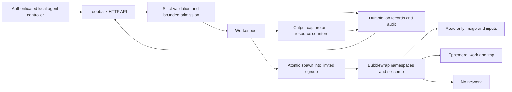

# Architecture and implementation decisions

## Lifecycle

`queued -> running -> succeeded | failed | timed_out | cancelled | output_limit |
resource_exhausted`. A queued cancellation is consumed by a worker without
executing it. A service restart changes persisted queued/running work to
`interrupted`. It never replays code, because the caller's actions might have
external side effects even in future backends.

Admission clones validated request data. Inputs and argv live in bounded memory
until the worker finishes; they are not copied into persistent job records.
Output is persisted privately and expires by count-based oldest-terminal-record
eviction. Listing results omits output; a caller fetches its job individually.
Execution timeouts begin when a worker starts the job; queue wait is separate.
Output is JSON text: invalid UTF-8 bytes are replaced by the JSON encoder. This
release does not provide a byte-preserving binary artifact channel.

An application nonzero exit is `failed`; limit/deadline/cancellation outcomes are
distinguished. OOM and PID-limit hits come from kernel counters. A missing
`memory.peak` file produces an omitted field, never a fabricated peak value.

## Isolation construction

The service runs as a dedicated unprivileged user. Bubblewrap must be a
root-owned, non-setuid executable. The rootfs and seccomp BPF program are trusted
operator artifacts, not selected by a job. No host `/usr`, `/etc`, home directory,
Docker socket, cgroup filesystem, or secret directory is bound into the guest.

Bubblewrap starts with fresh namespaces, clears its environment, drops all
capabilities, disables nested user namespaces, creates a new session, and loads
a default-deny native seccomp program. The image and job input mount are
read-only. Writable tmpfs mounts are charged to the already active memory
cgroup. The default filter denies sockets, namespace manipulation, ptrace, BPF,
mount operations, keyrings, perf events, io_uring setup, and other unlisted
syscalls. Only four descriptor-related ioctl requests are admitted.

## Atomic cgroup placement

Creating a child and then writing its PID into `cgroup.procs` leaves an execution
race and fails to move descendants already created. Instead, Go's
`SysProcAttr.UseCgroupFD` uses `CLONE_INTO_CGROUP`. Failure is fatal for that
execution; there is no fallback to post-launch migration.

The delegated service cgroup contains a `supervisor` leaf and one `job-<id>`
leaf per active execution. The trusted supervisor moves to its leaf before
enabling CPU, memory, and PID controllers in the parent. Job limits are written
before opening the cgroup FD and spawning the launcher. Completion and
cancellation both kill residual descendants and remove their cgroup. Cleanup
failure quarantines the service.

## Durability and audit ordering

Records are written to a private same-directory temporary file, flushed,
renamed, and followed by a parent-directory fsync on Linux. Admission is
acknowledged only after both record and audit persistence. A running transition
is audited and persisted before invoking the backend. Completed results become
visible only after persistence.

The record and audit are not a distributed transaction. A crash between writes
may leave an extra audit event or a queued/running record; restart interrupts
those records and does not execute them. Audit failure, storage failure, backend
infrastructure errors, or cleanup errors stop new admission and cancel work.

Audit entries have monotonically increasing sequence numbers and SHA-256 links.
Startup verifies the complete bounded chain and rejects partial trailing lines.
An attacker able to rewrite the entire log can recompute the chain. Independent
export/anchoring is necessary for adversarial tamper evidence.

## API and operational choices

Bearer secrets are generated with 256 bits of randomness; the server stores
only SHA-256 hashes and compares digests in constant time. Credentials are loaded
at startup, so rotation requires a controlled restart. The loopback listener and
rejection of browser Origin requests reduce accidental browser exposure. They
do not replace authentication or a remote TLS gateway.

The server sets header/body/read/write limits, returns request IDs, keeps output
out of logs, bounds worker/record counts, and exposes authenticated readiness
and metrics. Metrics are process-lifetime totals, not billing records.
